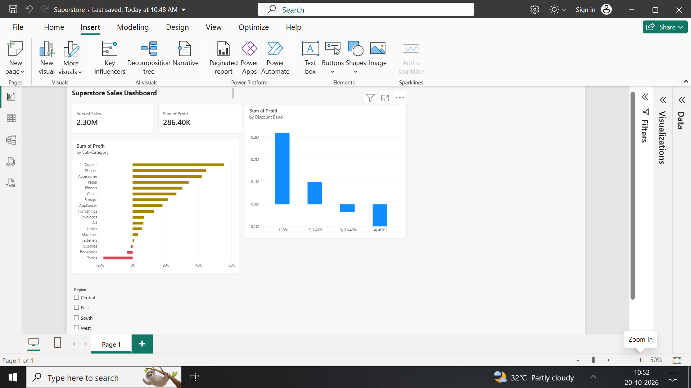

# Superstore Sales Analytics: Requirements to Dashboard

An end-to-end analytics project: business requirements, SQL analysis and an interactive Power BI dashboard, built to find where a retail store loses money.

## Business problem
A sales head wants to know which products lose money and whether discounting is hurting profit. Reports were built manually in Excel, which is slow and hard to repeat.

## Dataset
Sample Superstore (Kaggle): 9,994 order lines with Sales, Quantity, Discount and Profit.

## Tools
- SQL (SQLite, DB Browser for SQLite): CTEs, CASE, aggregations, window functions
- Power BI Desktop: data cleaning in Power Query, a calculated column (Discount Band), cards, charts and a Region slicer
- Requirements documentation: business requirements, user stories, acceptance criteria

## What I did
1. Wrote a Business Requirements Document with 15 requirements and 4 user stories (`requirements_doc.pdf`).
2. Loaded the data into SQLite and checked Sales, Profit and Discount for missing values.
3. Ran SQL analysis on profit by sub-category and profit by discount band (`queries.sql`).
4. Cleaned the data in Power Query (fixed date formats, set number types) and built the Power BI dashboard.
5. Checked that the dashboard figures match the SQL results.

## Key findings
- Total sales are about 2.30M and total profit is about 286.4K.
- Three sub-categories lose money: Tables (-17,725), Bookcases (-3,473) and Supplies (-1,189), a combined loss of about 22.4K.
- Profit falls as discounts rise:

| Discount band | Order lines | Profit | Margin |
|---|---|---|---|
| 0% | 4,798 | +320,988 | 29.5% |
| 1-20% | 3,803 | +100,785 | 11.9% |
| 21-40% | 460 | -35,817 | -15.3% |
| 40%+ | 933 | -99,559 | -77.4% |

- Order lines with discounts above 20% are about 14% of all lines (1,393 of 9,994) but produce a combined loss of about 135K.
- Supplies loses money at a low average discount (7.7%), so discounting alone does not explain every loss.

## Recommendation
Cap discounts at 20% unless a manager approves an exception, and review pricing for Tables and Bookcases first. Supplies needs a separate cost and pricing review.

## Files
| File | Description |
|---|---|
| `requirements_doc.pdf` | Business Requirements Document with user stories |
| `queries.sql` | SQL queries used in the analysis |
| `Superstore.pbix` | Power BI dashboard file |
| `dashboard_screenshot.png` | Screenshot of the dashboard |

## Author
Swati Pandita | [LinkedIn](https://www.linkedin.com/in/swati-pandita-315b83342)
